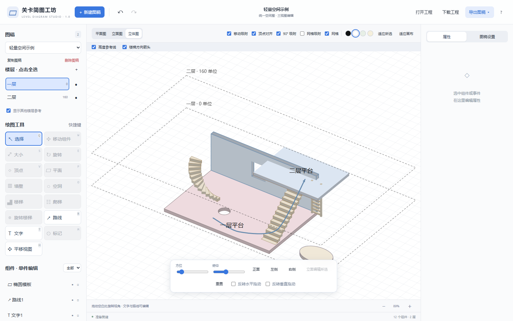
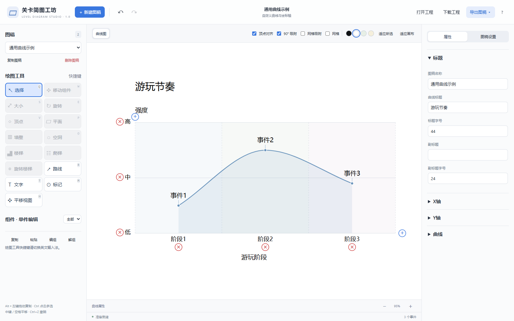

# 关卡简图工坊

用于关卡策划的轻量绘图工具：画空间布局，也整理游玩节奏。无需账号，可离线使用。



## 开始使用

- **在线使用**：仓库启用 GitHub Pages 后，在仓库右侧 About 或 Settings → Pages 获取网址。打开网址即可绘图，无需安装。
- **Windows**：从仓库的 Releases 下载 `LevelDiagramStudio-1.0.0-Windows-x64.exe`，双击启动。单文件便携版无需安装，首次启动会解包到临时目录；适用于 Windows 10/11 x64。
- **离线网页**：下载 Releases 中的 HTML，或下载仓库后打开 `dist/index.html`。推荐桌面版 Chrome / Edge。

程序顶部“使用说明”包含分组教程和 7 段操作演示；也可阅读[图文说明](docs/使用说明.md)，或下载[完整离线说明](docs/使用说明.html)后用浏览器打开。

## 主要功能

- 在同一空间图中切换平面、立面和立体视图，管理楼层与组件。
- 拖拽创建平面、墙壁和空洞，点击放置楼梯、爬梯、旋转楼梯及标记。
- 调整顶点、大小和方向，组件之间吸附；立体图支持世界三轴移动和 Alt 拖动复制。
- 添加文字、路线；绘制节奏或压力曲线，调整阶段、事件和坐标轴。
- 保存可继续编辑的 JSON 工程，预览并导出 PNG / SVG。



## 保存与数据

“下载工程”保存 JSON，“打开工程”恢复编辑。自动暂存仅保存在当前浏览器或桌面程序的本机配置中，不是云端保存；更换浏览器、网址或电脑前请下载 JSON。程序没有账号、遥测或云端工程服务，图稿不会自动上传。网站托管平台仍会接收正常的网页访问请求。

图稿可用于个人及商业项目。程序本身暂不授予源码修改和再分发许可，详见 [LICENSE](LICENSE)。第三方组件继续适用各自许可证，见[第三方说明](THIRD_PARTY_NOTICES.md)。

## 已知范围

工具面向简图表达，不代替三维建模软件。实体在立体图中只支持移动，旋转、大小与顶点编辑请切换平面或立面图。文字保留各视图字号调整与旋转，空洞始终依附宿主。工具快捷键请切换英文输入法；中文文字输入正常使用。

## 本地构建

需要 Node.js 24、npm 和 Python 3。依赖只用于构建、测试及桌面封装，网页版没有第三方运行时脚本。

```sh
npm ci
npm run build
npm test
python -X utf8 tools/build-manual.py
```

网页产物是 `dist/index.html`，可以直接离线打开或作为静态网站部署。`src/help/content.json` 同时驱动内置和外部教程，教学媒体在 `src/help/`，构建时嵌入，不可漏带。

在 Windows 构建桌面版：

```sh
npm run package:portable
python -X utf8 tools/package-release.py
```

输出在 `.build/portable/` 和 `release/`。开发依赖安装及首次下载 Electron / NSIS 构建工具需要联网；使用产物无需联网。单文件 EXE 包含完整 Electron 运行时，文件体积不代表网页程序本身体积。

## 维护与发布

[发布指南](docs/GitHub发布指南.md)包含仓库上传、GitHub Pages 网址启用和 Releases 附件的操作。`.github/workflows/pages.yml` 在推送 main 后构建、运行回归，再部署单独的网页目录；Pull Request 只运行检查。Windows 构建可手动运行对应工作流。

[最终检查记录](docs/最终检查记录.md)区分自动测试、实际浏览器操作、真实下载与桌面运行。网页、桌面版和 JSON 互通，但不会自动同步各端暂存。
