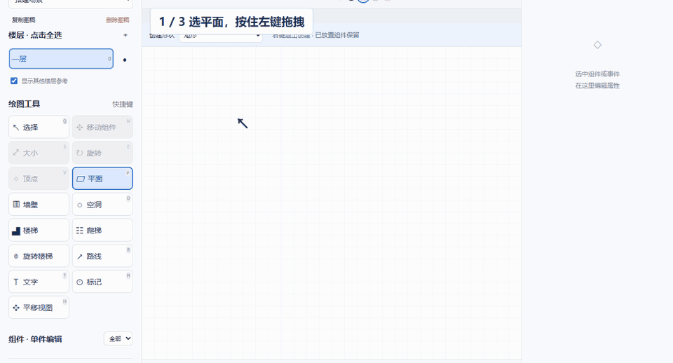
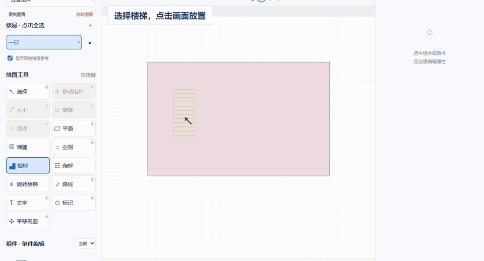
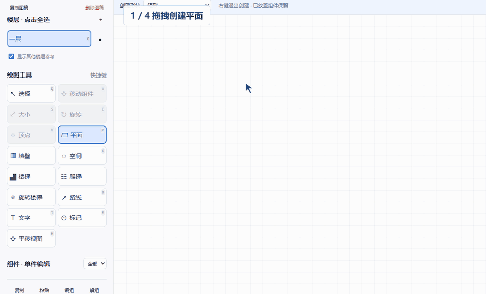
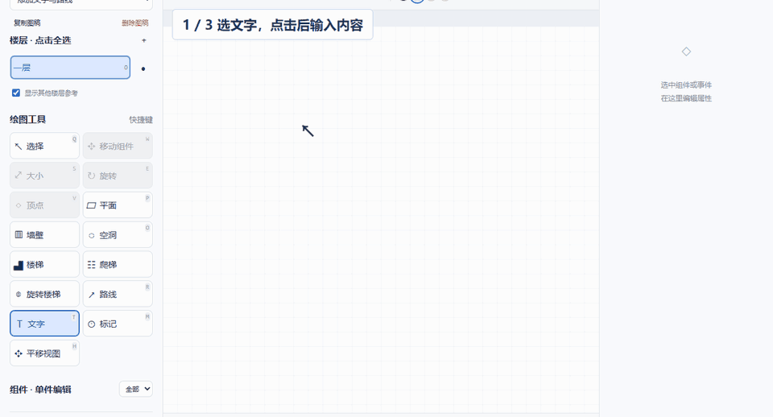

# 关卡简图工坊 · 使用说明

从搭建场景到导出图稿，按需要查看对应一组。点击演示可播放，再点一次停止。

## 查看与选择

**切换视图**：在画面上方选择平面图、立面图或立体图。

**调整画面**：滚轮缩放；按住中键，或按住空格再拖动，平移画面。立体图中拖动空白处转动视角。

**选择组件**：单击选中，Ctrl＋单击多选；平面图、立面图也可在空白处拖框多选。单击空白处取消选择。

**选择整组或单件**：画布中选择整组；需要单独编辑时，在左侧组件列表选择单件。双击列表中的名称可改名。

## 创建平面、墙壁与空洞

**平面和墙壁**：选择工具，按住左键拖出范围，松开完成。创建后可以继续拖拽创建下一个。

**空洞**：平面图中，在平面内部拖拽；立面图中，在墙壁内部拖拽。无需先选中宿主。

**结束创建**：按 Esc 或右键退出。也可单击组件退出并选中它；单击空白处退出并保留最新创建的组件。

## 放置楼梯与标记

**点击放置**：选择楼梯、爬梯、旋转楼梯或标记，移动到需要的位置，单击放置。

**继续或结束**：同一工具可连续放置多个组件；按 Esc 或右键结束。

## 移动与调整形状

**移动**：在平面图、立面图中选中组件，拖动到需要的位置。

**顶点**：选择“顶点”，拖动角点调整轮廓；点击边上的小圆点可添加顶点。

**大小**：选择“大小”，拖边改变长短，拖角等比缩放。

**旋转**：选择“旋转”，拖动圆环调整方向。Ctrl 可临时暂停吸附。

## 添加文字与路线

**文字**：选择“文字”，单击画面后输入内容。双击已有文字可修改内容，在编辑框旁或右侧属性中调整字号。

**路线**：选择“路线”，依次点击添加节点，按 Enter 或双击结束。选中路线后，直接拖动节点调整走向。

**增删路线节点**：点击节点之间的小圆点添加节点；点中一个节点后按 Delete 删除该节点。

## 立体图中的移动与复制

**沿轴移动**：选中组件，拖动 X、Y、Z 箭头，沿对应方向移动。

**沿平面移动**：拖动两轴之间的小方块，沿对应平面移动。手柄置灰时，转动视角后再操作。

**拖动复制**：按住 Alt 开始拖动坐标手柄，松开后放置副本；按 Esc 取消本次操作。

**其他编辑**：文字和路线仍可直接拖动；文字可用圆环旋转。实体的形状、大小和旋转，请切回平面图或立面图调整；空洞随所在平面或墙壁一起移动。

## 绘制曲线与编辑事件

**调整曲线**：新建图稿时选择“曲线图”。拖动事件节点，调整事件的位置和曲线高低。

**编辑事件**：双击事件文字修改名称；右侧“＋事件”可添加节点，点击曲线后也可用节点间的白点添加。

**整理图表**：在右侧展开标题、X 轴、Y 轴或曲线，修改对应内容。拖动事件名称左侧的六点手柄，调整名称顺序。

## 保存工程与导出图片

**继续编辑用工程文件**：点击“下载工程”保存 JSON；下次点击“打开工程”恢复。需要长期保留时，请下载工程文件。

**分享图片用导出图稿**：选择 PNG 或 SVG。完整图稿包含当前视图规则下的全部可见组件。

**只导出一部分**：选择“当前视野”，在预览中滚轮缩放、拖动取景，点击“导出文件”保存当前看到的画面。

## 常用快捷键

- 撤销 / 重做：Ctrl＋Z / Ctrl＋Shift＋Z
- 删除组件：选中组件后按 Delete
- 复制 / 粘贴：Ctrl＋C / Ctrl＋V
- 编组 / 解组：Ctrl＋G / Ctrl＋Shift＋G
- 退出当前操作：Esc

工具快捷键请使用英文输入法；按键标在左侧工具按钮上。文字输入期间不会切换工具。
