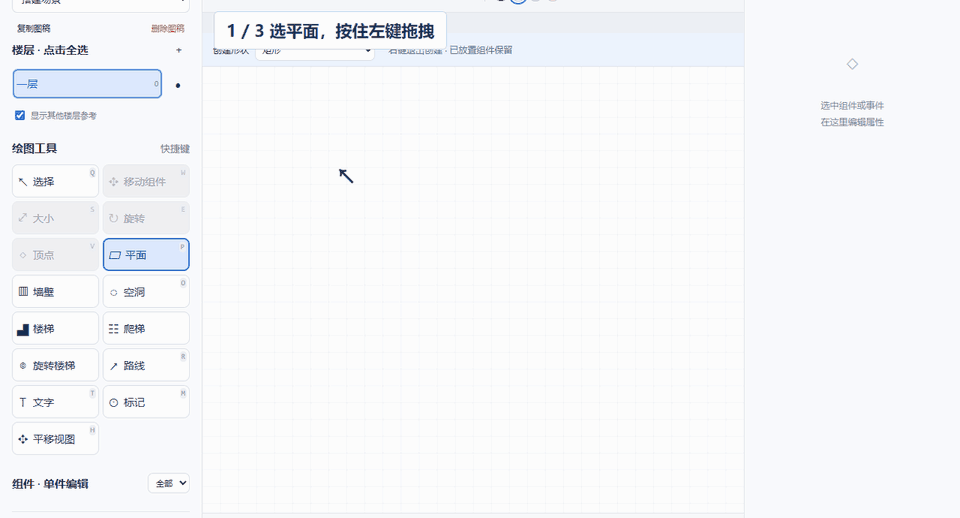
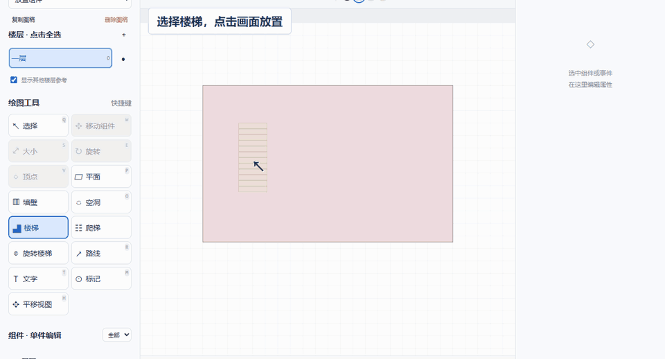
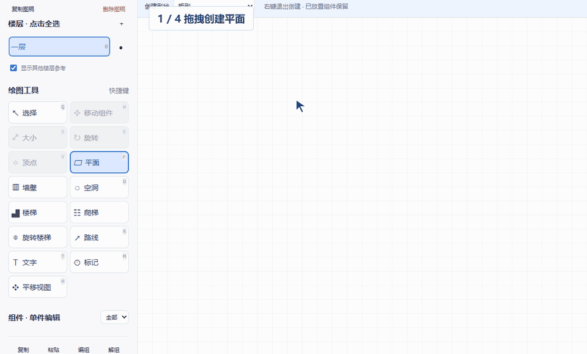
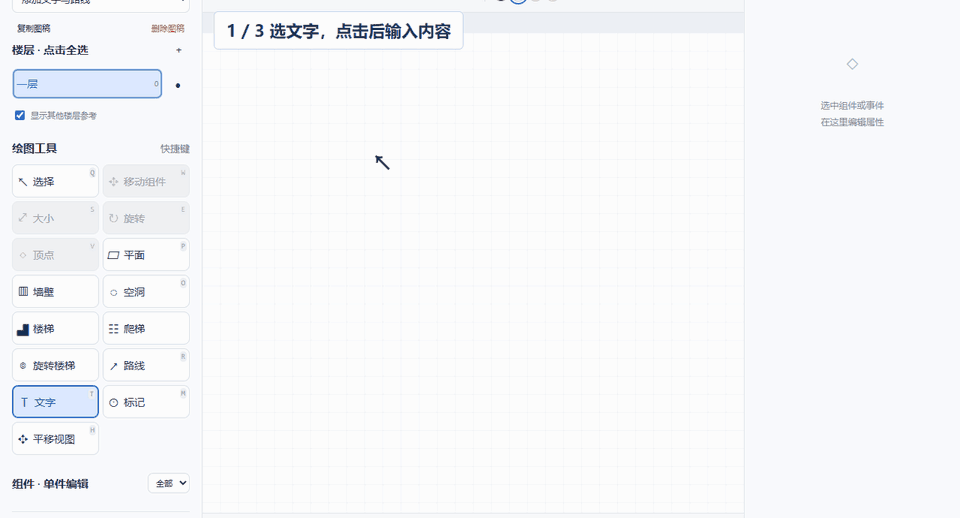
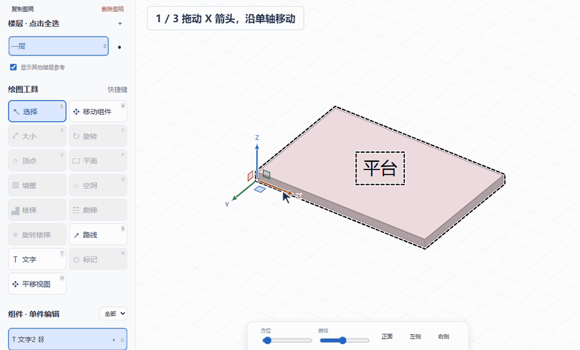
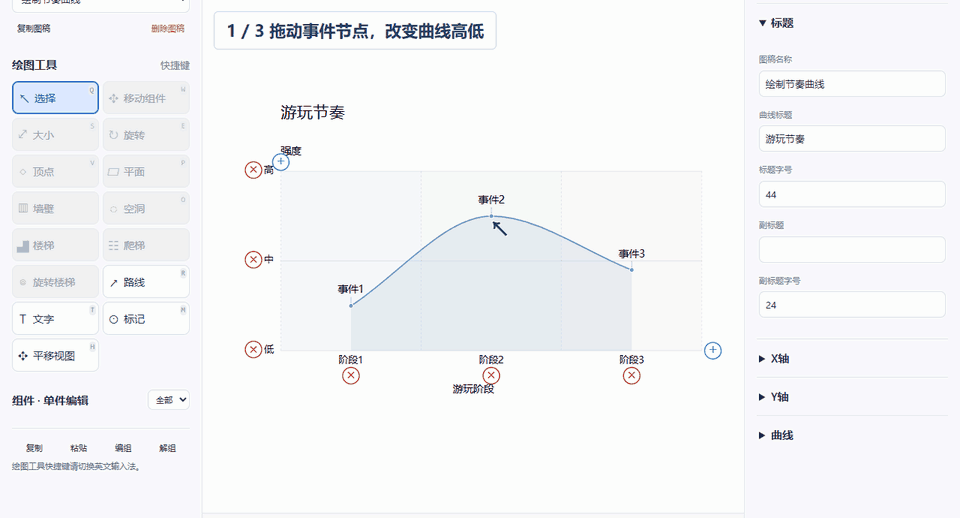
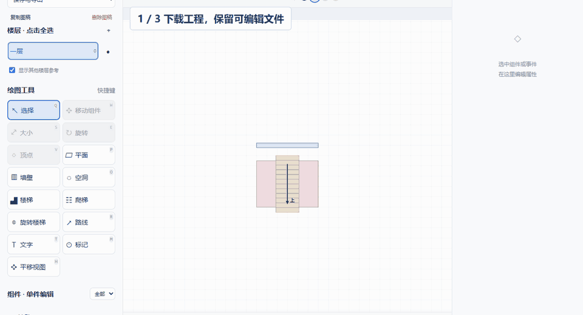

# 关卡简图工坊 · 使用说明

从搭建场景到导出图稿，按需要查看对应一组。点击演示可播放，再点一次停止。

## 查看与选择

**切换视图**：在画面上方选择平面图、立面图或立体图。

**工作区外观**：顶部“外观”可选择三种布局和三种配色，立即生效并记住此浏览器的设置；默认悬浮面板＋浅灰蓝。不改变画布、工程或导出图稿的颜色。

**面板收起与宽度**：悬浮布局首次左侧展开、右侧收起，之后记住状态。点击“属性”或“图稿设置”直接展开并切换，选中组件不会自动打开面板；左侧标题可收起。独立工具列和顶部工具带中，拖动面板与画布之间的边线调整宽度，双击恢复默认；工具列宽度固定。

**下方提示与缩放**：窗口底部保留一条操作提示，右侧是固定快捷键；缩放按钮在画布右下角，比例尺位于它上方。错误和限制以临时提示显示。

**工具可用状态**：切换视图时只显示该视图支持的工具；暂不可用的工具保留在原位并变灰，悬停可查看原因。悬浮布局的立体图工具与视角控制合在同一面板中。

**比例尺与公制**：勾选画面上方的比例尺，右下角显示距离，属性以米／厘米显示。默认1原单位为2厘米，原高度160显示3.2米，组件位置和形状保持原样。立体图只显示公制读数，不显示横向尺条。

**网格与地图范围**：顶部“比例尺”和“地图边界”的复选框只控制开启，点击名称打开各自设置，不会顺带开关功能。比例尺菜单设置基础格和吸附步长；地图边界菜单设置范围、提醒或限制，并提供512×512m预设。网格吸附总开关仍在上方；边界与图稿像素独立，关闭公制也能用原单位设置。

**尺寸与旧工程标定**：公制尺寸输入按Enter或离开输入框后提交，Esc取消本次输入；无效值恢复并提示。不规则轮廓显示只读的局部外接尺寸，圆弧编辑显示弧长、半径与弓高。高级标定先显示地图与原160单位的换算预览，点击应用才生效，可撤销；不会缩放原坐标。

**调整画面**：滚轮缩放；按住中键，或按住空格再拖动，平移画面。立体图中拖动空白处转动视角。改变窗口大小会保留观察中心与缩放；平移或观察拖动中按 Esc 恢复拖动前视角。

**选择组件**：单击选中，Ctrl＋单击多选；平面图、立面图也可在空白处拖框多选。单击空白处取消选择。

**选择整组或单件**：画布中选择整组；需要单独编辑时，在左侧组件列表选择单件。双击列表中的名称可改名。

**选择被挡住的组件**：在重叠处右键，直接列出鼠标位置的组件，并补充与当前墙面重叠的其他组件；楼梯稍微伸出墙外也可选。长列表可单独滚动，指向名称预览轮廓，点击选定；也可 Alt＋单击在鼠标附近轮选。锁定组件可查看属性，须解锁后移动。

**选中后移动**：右键候选或左侧列表选中单件后，移动工具 W 会保持操作该组件，即使它被墙挡住。Q 返回普通选择，可重新选择前方组件。

**分步退出**：Esc 先关闭菜单或退出输入框；拖动中取消本次操作；创建或调整工具中返回选择并保留组件；选择状态再按 Esc 清空选择。画布下方常驻当前工具和退出按钮。

## 创建平面、墙壁与空洞

**平面和墙壁**：选择工具，按住左键拖出范围，松开完成。创建后可以继续拖拽创建下一个。

**空洞**：平面图只给平面开洞，墙壁请切换立面图开洞；旧工程已有墙洞保留。空洞可跨边、重叠；先选中宿主可从外侧起笔。从另一组件内部起笔会改用该组件。

**调整空洞**：用移动、大小、旋转和顶点工具调整。切割方向在创建时固定；移出宿主显示“未相交”，删除空洞恢复宿主。不能完全切空宿主。

**结束创建**：按 Esc 或右键退出。也可单击组件退出并选中它；单击空白处退出并保留最新创建的组件。

## 放置楼梯与标记

**点击放置**：选择楼梯、爬梯、旋转楼梯或标记，移动到需要的位置，单击放置。

**继续或结束**：同一工具可连续放置多个组件；按 Esc、右键或画布下方的“退出创建”结束，保留最后放好的组件。

## 移动与调整形状

**先选中再移动**：未选中的组件第一次点击或拖动只完成选择，不移动、不复制。松开后，再拖动已选中的组件才移动；立体图实体和路线使用三色坐标轴。点击其他组件先改选，点击空白取消；已有尺寸、旋转控制点仍可直接操作。

**移动**：在平面图、立面图中选中组件，拖动到需要的位置。

**顶点**：选择“顶点”，拖动角点调整轮廓；点击边上的小圆点可添加顶点。

**圆弧与弯墙**：顶点工具中选择“圆弧”，拖边中虚点，端点保持不动。属性可输入弓高或恢复直线。墙壁可明确转换为等厚弯墙，再拖中心虚点。选择弯墙可“转为普通直墙”，连接两端，保留墙高、墙厚及孔的世界位置；转换可撤销。轮廓编辑则允许两侧厚度不同。

**大小**：选择“大小”，拖边改变长短，拖角等比缩放。

**旋转**：选择“旋转”，拖动圆环调整方向。Ctrl 可临时暂停吸附。

**复杂切割预览**：复杂弯墙或包含多个圆孔的墙壁，拖动期间保留实体预览并更新编辑轮廓，松手后计算完整结果。保存、导出使用完整几何。

## 添加文字与路线

**文字**：选择“文字”，单击画面后输入内容。双击已有文字可修改内容，在编辑框旁或右侧属性中调整字号。

**路线**：选择“路线”，依次点击添加节点，按 Enter 或双击结束。选中路线后，平面／立面图可拖动节点调整走向；立体图点击节点选择后，用三色坐标轴移动。绘制途中按 Backspace 撤回最后一点，Esc 取消未完成的路线。

**增删路线节点**：点击节点之间的小圆点添加节点；点中一个节点后按 Delete 删除该节点。

**路线遮挡**：路线属性的“遮挡方式”可选“始终显示”或“按空间遮挡”。旧工程保持始终显示；空间遮挡按真实高度和前后位置隐藏墙、平面后面的路线，真实洞口仍可见，不会自动把路线移入洞口。平面图是否应用、遮挡部分是否显示淡虚线可单独勾选。

**路线节点高度**：点击节点或在属性中选择节点，可设置相对当前楼层的高度；启用公制后以米输入。立面图拖动节点可调整高度，平面位置的纵深保持不变。选中路线节点时显示完整辅助线，方便找到隐藏节点；辅助线不进入导出。

## 立体图中的移动与复制

**沿轴移动**：选中组件，拖动 X、Y、Z 箭头，沿对应方向移动。

**沿平面移动**：拖动两轴之间的小方块，沿对应平面移动。手柄置灰时，转动视角后再操作。

**拖动复制**：按住 Alt 开始拖动坐标手柄，松开后放置副本；按 Esc 取消本次操作。

**其他编辑**：文字先选中后可拖动；文字可用圆环旋转。立体路线选中后用三色坐标轴移动整条路线，点击节点后坐标轴只移动该点；点击线条或按Esc返回整条路线。坐标轴始终放在当前视野内，不改变路线的实际位置。实体的形状、大小和旋转，请切回平面图或立面图调整；空洞随所在平面或墙壁一起移动。

## 绘制曲线与编辑事件

**调整曲线**：新建图稿时选择“曲线图”。拖动事件节点，调整事件的位置和曲线高低。

**编辑事件**：双击事件文字修改名称；右侧“＋事件”可添加节点，点击曲线后也可用节点间的白点添加。

**整理图表**：在右侧展开标题、X 轴、Y 轴或曲线，修改对应内容。拖动事件名称左侧的六点手柄，调整名称顺序。

## 插入图片与裁切

**直接插入**：点击工具栏“插入”，或将一张JPG、PNG、WebP图片拖到画布。图片自动等比放到合适大小，不要求先填写尺寸或校准；每次新增一张，每张空间图稿最多30张。图片仅在平面图及其导出显示，切到立面或立体图会提示已隐藏。

**选择与标注**：选择工具下直接点击图片内部或边框即可选中，也可通过左侧图片列表或右键菜单选择。叠在图片上方的路线、文字、标记优先选中；点击图片外的空白或按Esc清空选择。切换到绘图工具后可照常在图片上绘制。图片位于组件下方、网格上方，透明区域仍能看到下层。图片不参与开洞、顶点编辑、吸附或图例识别。

**移动、缩放与旋转**：第一次点击或拖动图片只选中，松开后再按住已选中的图片才能移动；点击图片外空白或按Esc取消选择。点击图片内外的其他组件会直接改选该组件。大小和旋转仍使用对应工具。拖角等比缩放，拖上方圆点旋转，Shift旋转以15°步进。裁切后的旋转以可见区域中心为轴。属性面板可改名、显示或隐藏、修改不透明度、尺寸、旋转及移除；不影响独立组件。

**无损矩形裁切**：在图片属性点击“裁切图片”，拖动四边或角点，或直接框出保留区域。Enter或“完成”应用，Esc取消；可撤销，也可“恢复完整图片”。裁切只隐藏外围，不移动或缩放保留的像素。切换工具或图稿会取消未完成的裁切。

**可选尺寸和校准**：不知道实际距离时直接使用即可。需要时展开“手动设置尺寸”，宽高联动；或点击“按已知距离校准”，在图上选两个端点后填写实际米数。校准固定第一个端点，只缩放底图，不移动组件、不更改工程比例。建议在绘制标注前校准；可另外选择同时启用比例尺。

**保存与导出**：下载工程会包含图片，在另一浏览器也能恢复；浏览器暂存只适合临时使用。PNG/SVG预览中可开关“包含图片底图”，并可按“底图范围”取景。SVG包含嵌入的图片和矢量标注。图例只识别本工具创建的组件，不识别图片内容。

**大图片**：超过4096像素边长或1600万像素时，可选择缩小副本、保留原图或取消，原文件不变。当前单图限制20MB、最长边8192像素、3200万像素。含图片的工程需使用支持图片底图的新版本打开。 多图或裁切工程使用新版格式10保存，旧版网页可能无法打开，请使用本地新版。

## 保存工程与导出图片

**继续编辑用工程文件**：点击“下载工程”保存 JSON；下次点击“打开工程”恢复。需要长期保留时，请下载工程文件。

**分享图片用导出图稿**：选择 PNG 或 SVG。完整图稿包含当前视图规则下的全部可见组件。启用比例尺后可在导出预览中选择是否包含尺条；图片倍率不会改变表示的实际距离。平面图启用地图边界后，可按地图边界导出，选择匹配地图长宽比或保留图稿画幅。匹配以图片宽度为基准调整输出高度，保留画幅会留白，均不拉伸组件。

**只导出一部分**：选择“当前视野”，在预览中滚轮缩放、拖动取景，点击“导出文件”保存当前看到的画面。

**添加图例**：在“图例与地图信息”中开启图例，点击列表顶部“＋添加图例项”。按路线、区域或标记查看真实样式与组件名称；指向候选会在地图中高亮。勾选后点击“添加所选”，再直接修改名称。已添加的来源会标记，避免重复；文字说明可单独添加。

**整理图例**：Ctrl／Shift＋单击可多选样式项并合并；拖动左侧手柄排序，也可在“更多操作”中上下移、拆分或移除。显示开关只控制是否导出，移除图例不删除地图组件。点击左侧图例可定位到右侧编辑项；名称按 Enter 更新，Esc 取消当前输入。标题与来源范围在“更多设置”中。

**图例背景颜色**：下方图例区默认跟随画布背景。取消“跟随画布颜色”后，可单独选色或输入6位颜色值，地图颜色不变；重新勾选即可恢复跟随。图例文字、描边及下方比例尺／指北针会自动适应背景，色块和路线主色保持与地图对应。颜色配置随工程保存。

**比例尺与指北针**：图例、比例尺、指北针各有独立开关。比例尺可放在图内右下或图稿下方；指北针可放在图内右上或图稿下方，并调整方向。下方区域只增加输出高度，不改变地图比例。比例尺需先设置公制尺度，立体图不显示普通尺条；指北针仅用于平面图，表示用户设定的“规划北”，不自动认定地理真北。关闭开关保留配置，下载工程保存。

## 常用快捷键

- 撤销 / 重做：Ctrl＋Z / Ctrl＋Shift＋Z
- 删除组件：选中组件后按 Delete
- 复制 / 粘贴：Ctrl＋C / Ctrl＋V
- 编组 / 解组：Ctrl＋G / Ctrl＋Shift＋G
- 退出当前操作：Esc
- 轮流选择重叠组件：Alt＋单击
- 回退未完成路线的节点：Backspace
- 菜单中移动焦点：↑ / ↓；Enter 执行；Esc 关闭

工具快捷键请使用英文输入法；悬停工具按钮可查看快捷键，暂不可用的工具会说明原因。文字输入期间不会切换工具。
